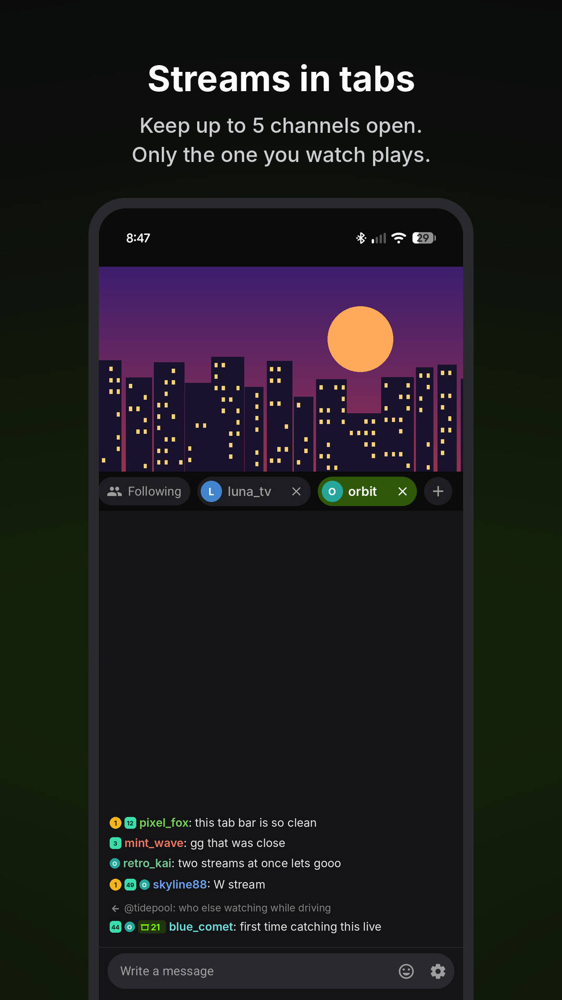
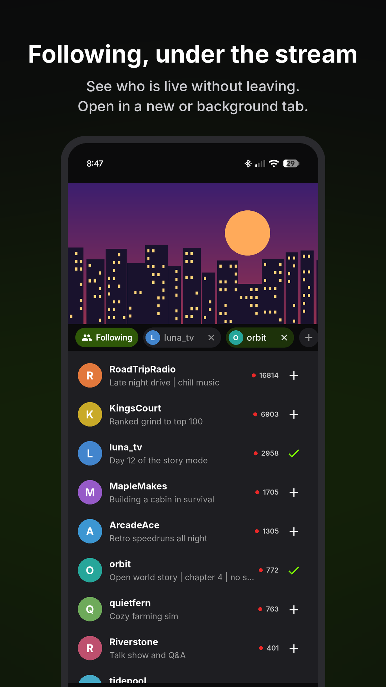
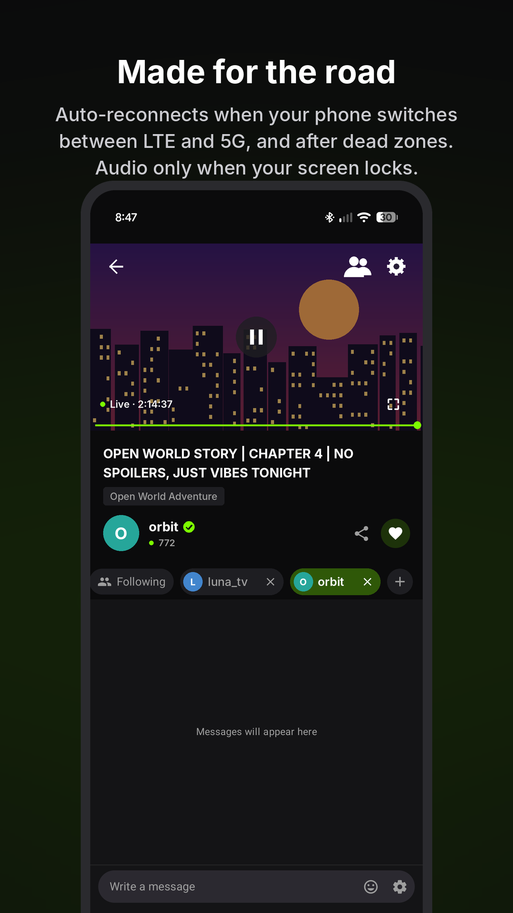

<div align="center">
<br />

</div>

<h1 align="center">KickOnTheGo (KOTG)</h1>

<p align="center">
  Kick streams in tabs, made for listening on the go.<br />
  An unofficial Android app for Kick, built on <a href="https://github.com/Gallbladderz/OpenKick">OpenKick</a>.
</p>

<p align="center">
  <a href="https://github.com/sydnorlabs/KickOnTheGo/releases/latest">Download the latest APK</a>
  &nbsp;·&nbsp;
  <a href="https://ko-fi.com/sydnorlabs">Support on Ko-fi</a>
</p>

<p align="center">
  
  
  
</p>

## What it adds

- **Stream tabs:** keep up to 5 channels open and switch in one tap. Only the tab you're on plays, so it stays light on battery and data.
- **Following under the stream:** see who's live without leaving the player, and open them in a new or background tab. The list loads when the player opens and refreshes every 2 minutes.
- **Made for the road:** auto-reconnects when your phone switches between LTE and 5G, or Wi-Fi and cellular, and keeps retrying through dead zones.
- **Audio only on lock:** video pauses when your screen locks and comes back when you return. Tapping the notification opens the player with chat.
- **Back to live:** jumps back to live after a stall, unless you rewind on purpose.

Everything else comes from OpenKick 1.4: Kick sign-in, live rewind, clips and VODs, downloads, 7TV emotes, chat replay and more.

## Why I made it

I listen to Kick streams while I drive. Listening in my browser drained my battery, so I switched to OpenKick. Two things kept getting in the way. I like to easily switch through and listen to multiple streams while on the go, and I wanted that without the battery hit. And every time my phone hopped between LTE and 5G the stream froze and I had to reload it, which isn't something you can do while driving.

So I built KickOnTheGo with Claude Duet: tabs for up to 5 streams where only one plays, a Following list right under the stream, and a player that reconnects on its own when the network changes.

## Install

Download `KickOnTheGo-1.0.0.apk` from [Releases](https://github.com/sydnorlabs/KickOnTheGo/releases) and open it on your phone (Android 8.0 or later). To get updates automatically, add this repo's URL in [Obtainium](https://github.com/ImranR98/Obtainium).

KickOnTheGo installs as its own app (`dev.sydnorlabs.kickonthego`), so it can sit next to OpenKick.

## Support

KickOnTheGo is free and open source. If it makes your drive or your day better, a donation helps me keep it updated with each new OpenKick release and keep my build server running: [ko-fi.com/sydnorlabs](https://ko-fi.com/sydnorlabs)

## Build

Use JDK 17 or later and Android SDK Platform 36.

```bash
./gradlew :app:assembleDebug
```

Release builds are signed with a key kept outside the repo. Point Gradle at a properties file with `storeFile`, `storePassword`, `keyAlias` and `keyPassword`:

```bash
./gradlew :app:assembleRelease -PkotgKeystoreProps=/path/to/keystore.properties
```

## Credits and license

KickOnTheGo is a fork of [OpenKick](https://github.com/Gallbladderz/OpenKick) by Gallbladderz. All of OpenKick's work stays under its original copyright, and KickOnTheGo is released under the same [GNU GPL-3.0](LICENSE).

KickOnTheGo is not made by, endorsed by or affiliated with Kick. Kick is a trademark of its owner.
